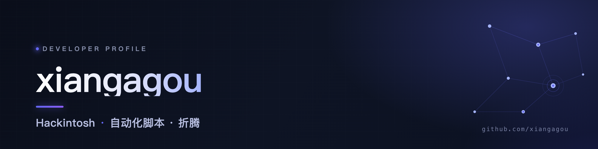

  

<h3 align="center">你好，我是 Mike（xiangagou）👋</h3>

  <em>Hackintosh · 自动化脚本 · 折腾 · On GitHub since 2014</em>

  老派折腾党：Hackintosh、自动签到脚本、以及各种自托管实验。 
  Old-school tinkerer into Hackintosh builds, automation scripts, and self-hosting experiments.

---

### 🧰 技术栈 · Tech Stack

  
  
  
  
  
  
  

### 📊 GitHub 统计 · Stats

  

  

  

### 🚀 精选项目 · Featured Projects

| 项目 Project | 简介 | 链接 |
| :--- | :--- | :--- |
| **Dell-E6440-Hackintosh** | Dell E6440 Hackintosh 启动包（实测可用） | [仓库](https://github.com/xiangagou/Dell-E6440-Hackintosh) |
| **cloud189-action** | 天翼云盘自动签到 + 抽奖 | [仓库](https://github.com/xiangagou/cloud189-action) |
| **My-Actions** | 多平台自动签到脚本合集 | [仓库](https://github.com/xiangagou/My-Actions) |
| **nacos-k8s** | 在 K8s 上用 StatefulSet 部署 Nacos | [仓库](https://github.com/xiangagou/nacos-k8s) |

### 🔗 我的其他账号 · Also on

  
  

感谢访问 · Thanks for stopping by ✦

